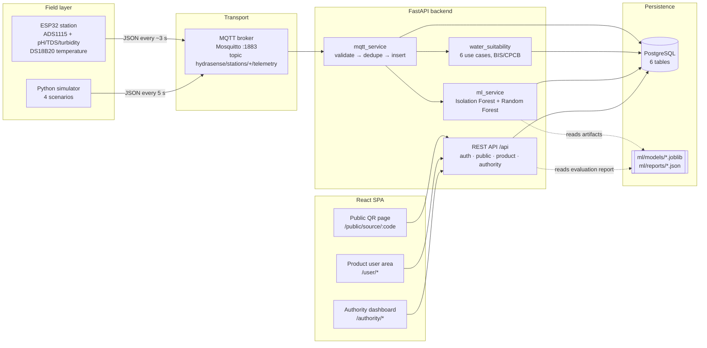
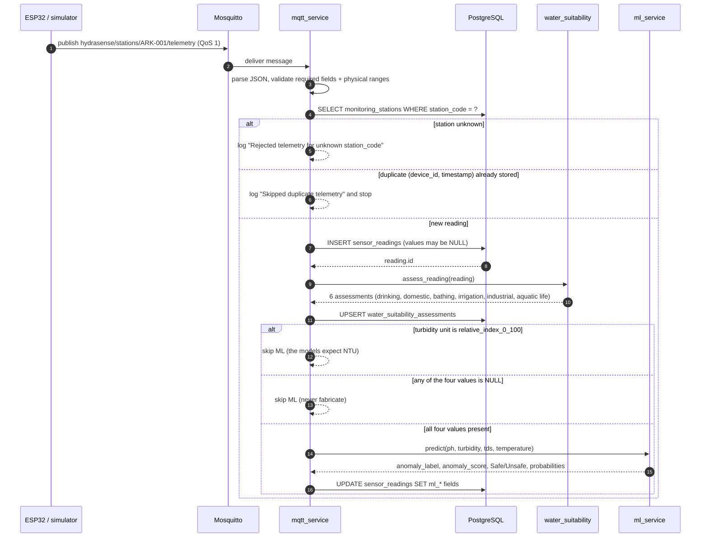
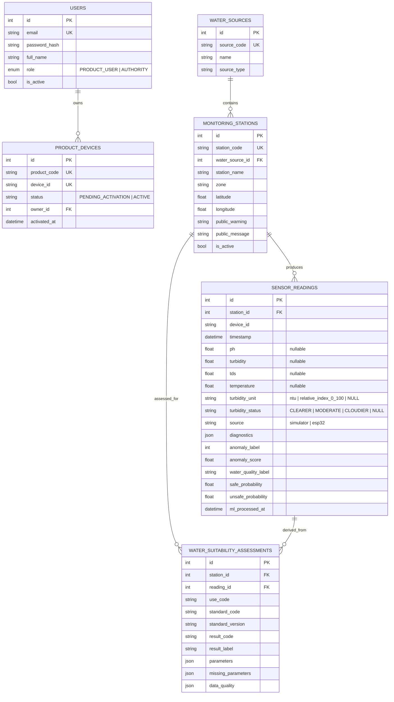
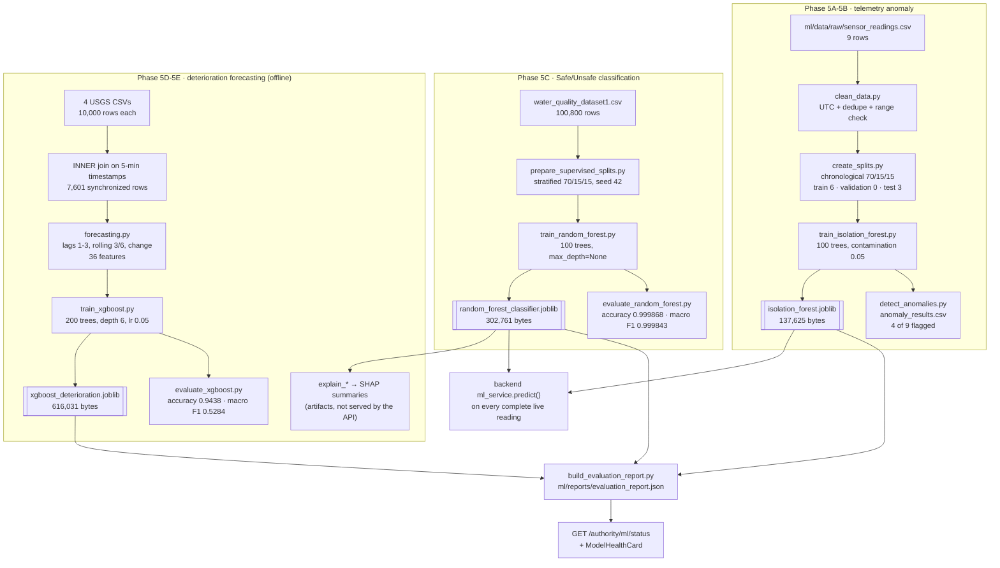

# HydraSense — Complete Project Guide

> **What this document is.** A walkthrough of the HydraSense repository as it actually exists on
> disk, written for a final-year project presentation. Every number, route, table and file path
> below was read or executed in this checkout. Where something is a demo, a placeholder, or an
> inference rather than a verified fact, it says so explicitly.
>
> Companion documents:
> - [FEATURE_STATUS.md](FEATURE_STATUS.md) — what is real, partial, or UI-only (read this before demoing)
> - [DATASET_CATALOG.md](DATASET_CATALOG.md) — every dataset with real counts and provenance
> - [DATA_CLEANING_REPORT.md](DATA_CLEANING_REPORT.md) — exactly which cleaning operations ran
> - [PRESENTATION_DEMO_GUIDE.md](PRESENTATION_DEMO_GUIDE.md) — the demo script
> - [PRESENTATION_QA.md](PRESENTATION_QA.md) — likely examiner questions with honest answers
> - [PROJECT_AUDIT_REPORT.md](PROJECT_AUDIT_REPORT.md) — audit findings and remaining work

---

## 1. What HydraSense is

HydraSense is a water-quality intelligence platform with four cooperating parts:

1. **A physical station** (ESP32 + ADS1115 ADC + pH/TDS/turbidity probes + DS18B20 temperature)
   that publishes JSON telemetry over MQTT.
2. **A FastAPI backend** that validates and stores that telemetry in PostgreSQL, runs two trained
   scikit-learn models on each complete reading, and computes standards-based water-suitability
   assessments.
3. **A machine-learning workspace** (`ml/`) containing the datasets, the training scripts, the
   three persisted model artifacts, and a reproducible evaluation report.
4. **A React 19 single-page app** with three surfaces: a public QR-linked water-body page, a
   product-user area (devices, personal checks), and an authority dashboard.

The project's defining engineering choice is **honesty about missing data**: an uncalibrated
sensor stores `NULL`, an unavailable model stores `NULL`, a relative turbidity index is never
labelled NTU, and the API never invents model metrics. That choice is visible in the schema, the
services, the UI states and the test suite.

---

## 2. Verification snapshot (what was executed for this audit)

| Check | Command | Result |
|---|---|---|
| Backend tests | `cd backend && python -m pytest tests -q` | **668 passed**, 4 warnings, 378 s |
| ML tests | `python -m pytest ml/tests -q` | **140 passed**, 23 s |
| Frontend tests | `cd frontend && npm test` | **74 passed** in 6 files, ~10 s |
| Frontend lint | `cd frontend && npm run lint` | 0 errors, 1 warning (`react-refresh` on `components/ui/button.tsx`) |
| Frontend build | `cd frontend && npm run build` | exit 0 (`tsc -b && vite build`); Vite warns one chunk > 500 kB |
| ML evaluation | `python ml/scripts/build_evaluation_report.py` | rewrote `ml/reports/evaluation_report.json` with identical metrics |
| Dataset cleaning | `python ml/preprocessing/clean_datasets.py` | 6 datasets, 140,809 rows in → 140,809 out, 0 removed, all checks pass |

**Total automated tests: 882 (668 + 140 + 74), all passing.**

Runtime pinned in the evaluation report: Python 3.11.9, scikit-learn 1.4.2, pandas 2.2.2,
numpy 1.26.4.

---

## 3. System architecture



Two ingestion routes write the same table: **simulator** rows (`source='simulator'`, NTU-style
turbidity) and **hardware** rows (`source='esp32'`, provisional relative turbidity index). The
`source`, `turbidity_unit`, `diagnostics` columns exist so downstream code can never confuse them.

---

## 4. One telemetry packet, end to end



Facts that matter for the presentation:

- The reading is **committed before** assessment and ML run. A failure in either never loses telemetry.
- The duplicate guard keys on `(station_id, device_id, timestamp)` — MQTT QoS 1 redelivery is safe.
- Unknown `station_code` is **rejected**, not auto-created. Stations are seeded
  (`backend/scripts/seed_demo.py` creates `ARK-001`, `ARK-002`, `ARK-003`).
- Suitability is written for **every** reading at ingestion (6 rows, one per use case, unique per
  `(reading_id, use_code, standard_version)`).

---

## 5. Data model



Six tables, seven Alembic migrations:

| Revision | Purpose |
|---|---|
| `7149f0321ee9` | initial schema |
| `1643d0d682b5` | authentication + monitoring tables |
| `579c2249f273` | sensor_readings table |
| `a1b2c3d4e5f6` | ML result columns on readings |
| `b7e6f0a1c2d3` | `source` + `diagnostics` (hardware provenance) |
| `c3d4e5f6a7b8` | `turbidity_unit` + `turbidity_status` |
| `d4e5f6a7b8c9` | water_suitability_assessments |

The recent migrations are deliberately **non-destructive**: they add nullable columns, backfill
only what can be derived honestly (`source='simulator'` → `turbidity_unit='ntu'`), and never
rewrite a measurement.

---

## 6. API surface

Base path `/api`. Interactive docs at `/docs`.

| Method | Path | Auth | Purpose |
|---|---|---|---|
| GET | `/` | none | liveness + project metadata |
| POST | `/auth/register` | none | create account, optionally bind a product code |
| POST | `/auth/login` | none | JWT (HS256, 60 min) |
| GET | `/public/stations/{code}` | none | station + water source for the QR page |
| GET | `/public/stations/{code}/readings/latest` | none | latest public-safe reading |
| GET | `/public/stations/{code}/readings?limit=` | none | history for the trend chart (1–200) |
| GET | `/public/stations/{code}/suitability` | none | 6-use assessment of the latest reading |
| GET | `/product/me` | PRODUCT_USER | own profile |
| GET | `/product/devices` | PRODUCT_USER | own devices |
| GET | `/authority/me` | AUTHORITY | own profile |
| GET | `/authority/stations` | AUTHORITY | all stations, stable code order |
| GET | `/authority/stations/{code}/readings` | AUTHORITY | history |
| GET | `/authority/stations/{code}/readings/latest` | AUTHORITY | latest + diagnostics |
| GET | `/authority/stations/{code}/readings/latest/analysis` | AUTHORITY | latest + ML fields |
| GET | `/authority/readings/{id}/analysis` | AUTHORITY | any reading + ML fields |
| GET | `/authority/stations/{code}/suitability` | AUTHORITY | 6-use assessment |
| GET | `/authority/ml/status` | AUTHORITY | model load state + evaluation report |

RBAC is enforced by `app/api/deps.py`: `get_current_user` validates the JWT, then
`require_role([...])` produces `get_current_product_user` / `get_current_authority`. Cross-role
access returns 403 (covered by `backend/tests/test_rbac.py`).

Public endpoints are public-safe **by schema**: `PublicLatestReading` has no `diagnostics`, no
device credentials and no internal IDs beyond the station code.

---

## 7. Machine-learning pipeline



### What each model actually claims

| Model | Task | Trained on | Live in the API? | Honest reading of its output |
|---|---|---|---|---|
| Isolation Forest | Unsupervised anomaly screening | 6 telemetry rows (chronological train split) | Yes | "This pattern is unusual relative to the 6-row baseline" — not pollution |
| Random Forest | Binary Safe/Unsafe classification | 100,800-row benchmark table, 70,560-row train split | Yes | "The benchmark's own label rule, applied to these four numbers" — not potability |
| XGBoost | Next-observation deterioration indicator | 5,321 rows from one USGS station | **No** (offline only) | "Rule-based deterioration flag from USGS lag/conductivity features" |

### The 99.99 % accuracy question — answer it before the examiner asks

The Random Forest reaches **accuracy 0.999868** (2 errors in 15,120 test rows). That is a red flag,
not a triumph, and the repository treats it as one:

- The benchmark's `Label` is a deterministic function of the same four features. A flexible model
  trivially reconstructs the rule; the score measures **rule recovery**, not real-world skill.
- The test split is from the same static table (same distribution) — no temporal or site shift.
- There is **no evidence** this accuracy transfers to live ESP32 readings. The report says this
  explicitly in `limitations`.

The more informative numbers are the **XGBoost** ones: accuracy 0.9438 looks good, but balanced
accuracy is 0.5376 and the Unsafe class has recall 0.111 (3 of 27 caught). That is what an
imbalanced real time series looks like, and the report publishes it rather than hiding it.

---

## 8. Water Suitability Assessment

`backend/app/services/water_suitability.py`, ruleset version **`2026.10.1`**, six use cases:

| `use_code` | Standard | Criteria used |
|---|---|---|
| `drinking` | BIS IS 10500:2012 (Amd. 4) Table 1 | pH 6.5–8.5, TDS 500/2000 mg/L, turbidity 1/5 NTU + 8 required lab parameters reported missing |
| `domestic` | BIS IS 10500:2012 | same physical criteria, potable-domestic caveat |
| `bathing` | CPCB DBU Class B | pH, DO, BOD, coliform (unmeasured → reported missing) |
| `irrigation` | CPCB DBU Class E | pH 6.0–8.5, EC ≤ 2250 µS/cm, SAR, boron |
| `industrial` | CPCB DBU Class E | cooling/industrial criteria |
| `aquatic_life` | CPCB DBU Class D | pH, DO, free ammonia |

Guard rails, all enforced in code:

- Only `source == "esp32"` **and** `calibration_status == "calibrated"` readings are compared.
- Turbidity must be stored as NTU; a relative index is excluded from the comparison.
- Readings older than 5 min are `delayed`, older than 60 min `stale` — never presented as current.
- Missing parameters are listed as missing; the engine never assumes a value.
- **Drinking water can never return `preliminary_suitable`** — microbiology is required and this
  station cannot run it. The best it can return is `lab_confirmation_required`.
- Result codes: `preliminary_suitable`, `treatment_required`, `outside_limits`,
  `lab_confirmation_required`, `insufficient_data`.

Assessments are persisted as derived rows (unique per reading + use + ruleset version), so the
history is auditable and recomputation is idempotent.

---

## 9. Frontend map

React 19 + Vite + Tailwind 4 + react-router 7, `frontend/src`.

| Route | Page | Data source |
|---|---|---|
| `/public` | Home | static content, links to `ARK-003` |
| `/public/check-water` | WaterCheck | **client-side rules over `mockData`** |
| `/public/sources` | NearbySources | `mockData` |
| `/public/warnings` | Warnings | `mockData` |
| `/public/my-checks` | MyChecks | hard-coded array |
| `/public/source/:stationId` | PublicSource | **real API** (`publicApi`, 3 calls) |
| `/user/login`, `/user/register` | Login/Register | **real API** (`authApi`) |
| `/user/activate` | Activate | **no API** — accepts any code, navigates to dashboard |
| `/user/dashboard` | UserDashboard | **real API** (`productApi.getProfile`) |
| `/user/devices` | UserDevices | **real API** (`productApi.getDevices`) |
| `/user/check-water` | UserCheckWater | **UI simulation** — 3 s timer, no backend |
| `/user/history` | UserHistory | hard-coded array |
| `/authority` | CommandCenter | mixed: station list + ML summary real; cards, alerts, trend, sensor health from `mockData` |
| `/authority/monitoring` | LiveMonitoring | mixed: backend station selector, telemetry card, ML card, suitability, QR **real**; top board from `mockData` |
| `/authority/map` | WaterMap | **real API** (stations); map itself is a styled placeholder |
| `/authority/analytics` | Analytics | `mockData` + **real** `ModelHealthCard` |
| `/authority/alerts` `/incidents` `/inspections` `/laboratory` | — | `mockData` only; acknowledge/reset is local state |
| `/authority/stations/:stationId` | StationDetail | `mockData` keyed by mock id, with a real `MlLatestCard` that will 404 because mock ids are not station codes |
| `/authority/sources` | WaterSources | `mockData` |

The `useLatestAnalysis` hook fetches `/authority/stations/{code}/readings/latest/analysis` and
distinguishes four states: `success`, `unavailable` (404/409 — no reading or no ML), `unauthorized`,
`error`. That is why the UI can say "Analysis unavailable" instead of faking a verdict.

---

## 10. Firmware and simulation

**Firmware** (`firmware/hydrasense_esp32/hydrasense_esp32.ino`, 470 lines) + setup guide in
[firmware/README.md](../firmware/README.md).

- ADS1115 on I²C (SDA 21, SCL 22, ±4.096 V, addr 0x48): A0 pH, A1 TDS, A2 turbidity through a
  two-resistor divider (input must stay ≤ 3.3 V).
- DS18B20 on GPIO 4 with a 4.7 kΩ pull-up.
- Publishes `hydrasense/stations/<CODE>/telemetry` every ~3 s, `source:"esp32"`, controlled by
  `DEVICE_ID` / `STATION_CODE` in `config.h` (gitignored).
- Calibration flags start at `0`: uncalibrated sensors publish `null` plus raw ADC/voltage in
  `diagnostics`; turbidity publishes a **provisional relative index 0–100** with
  `diagnostics.turbidity.unit = "relative_index_0_100"`.
- Will not publish before NTP sync (honest UTC timestamps).
- **Status:** code complete and consistent with the backend contract and tests. It has **not** been
  verified on hardware in this audit — do not claim a live hardware demo unless you run one.

**Simulator** (`backend/simulator/sensor_simulator.py`): publishes every 5 s (configurable) with
scenarios `normal`, `deteriorating`, `sudden_event`, `sensor_fault`. Simulator values are for
pipeline testing and are never treated as scientific ground truth.

---

## 11. Running the system

Full commands, prerequisites and troubleshooting live in [README.md](../README.md). Minimum path
for a demo:

```bash
# 1. database + backend
cd backend
alembic upgrade head
python scripts/seed_demo.py            # ARK-001..003, authority user, product device
python scripts/seed_ml_readings.py     # demo readings with ML results
python -m uvicorn app.main:app --host 127.0.0.1 --port 8000

# 2. broker (Mosquitto) must be running on 1883 for live telemetry
# 3. simulator (optional)
python backend/simulator/sensor_simulator.py --scenario normal --interval 5

# 4. frontend
cd frontend && npm install && npm run dev     # http://localhost:5173
```

Environment variables: `backend/.env` (`DATABASE_URL`, `JWT_SECRET_KEY`, `MQTT_BROKER_HOST`,
`MQTT_BROKER_PORT`, `MQTT_TOPIC_PREFIX`) and `frontend/.env` (`VITE_API_BASE_URL`, optional
`VITE_PUBLIC_BASE_URL` for LAN-reachable QR links).

**Do not run `python run_server.py`** — it refuses to serve without an import string; use
`python -m uvicorn app.main:app`.

Demo authority login: `authority@hydrasense.local` / `DemoAuthority123!` (seeded; change it in any
real deployment).

---

## 12. Repository layout

```
hydrasense-water-intelligence/
├── backend/                 FastAPI app, models, services, tests, migrations, simulator, seeds
│   ├── app/api/v1/          auth.py public.py product.py authority.py
│   ├── app/models/          user.py device.py water.py
│   ├── app/services/        mqtt_service.py ml_service.py ml_status_service.py water_suitability.py
│   ├── app/schemas/         pydantic request/response contracts
│   ├── alembic/versions/    7 migrations
│   ├── scripts/             seed_demo.py seed_ml_readings.py
│   └── tests/               668 tests (SQLite in-memory, no broker needed)
├── ml/                      datasets, preprocessing, scripts, models, reports, tests
│   ├── data/external/       4 USGS CSVs + benchmark table
│   ├── data/raw/            sensor_readings.csv export
│   ├── data/processed/      splits, predictions, SHAP, anomaly results, cleaned/ copies
│   ├── preprocessing/       clean_data.py features.py forecasting.py prepare_supervised.py
│   │                        clean_datasets.py (this audit)
│   ├── scripts/             24 pipeline scripts (splits → train → evaluate → report)
│   ├── models/              3 joblib artifacts
│   └── reports/             evaluation_report.{json,md}, dataset_cleaning_report.{json,md}
├── frontend/                Vite + React 19 SPA
├── firmware/                ESP32 sketch + config template + hardware guide
└── docs/                    this documentation set
```

---

## 13. Things that are easy to misstate in a presentation

Say these the way they are written here:

1. **"Machine learning model"** → two live scikit-learn models (anomaly + classification) and one
   offline XGBoost experiment. No deep learning, no LLM, no online learning.
2. **"Predicts water safety"** → predicts the benchmark dataset's Safe/Unsafe label from four
   parameters. It is not a laboratory test and not potability.
3. **"99.99 % accurate"** → accurate at reproducing a deterministic label rule on a static table.
   Add the sentence about the XGBoost balanced accuracy (0.5376) as the realistic counterpoint.
4. **"Real-time monitoring"** → MQTT ingestion and REST reads are real; several dashboard panels
   still render `mockData`. Check [FEATURE_STATUS.md](FEATURE_STATUS.md) before clicking around live.
5. **"AI alerts"** → there is no alert engine, no notification channel, no incident workflow in the
   backend. The Alerts/Incidents/Inspections/Laboratory pages are UI prototypes.
6. **"ESP32 deployed at a river"** → firmware is written and contract-tested, but hardware
   deployment is not verified in this repository.
7. **"TDS from USGS"** → the USGS data provides **specific conductance (µS/cm)**, which is not TDS
   and is never converted to TDS anywhere in this codebase.
